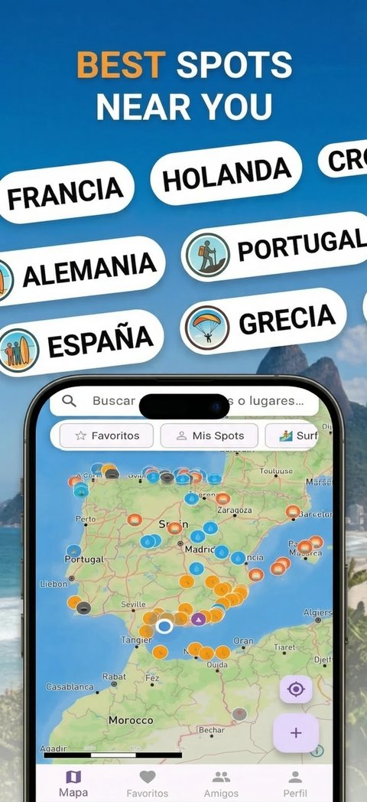
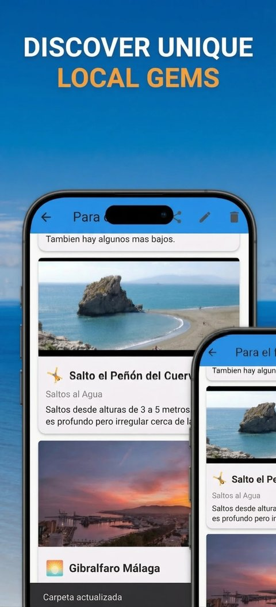
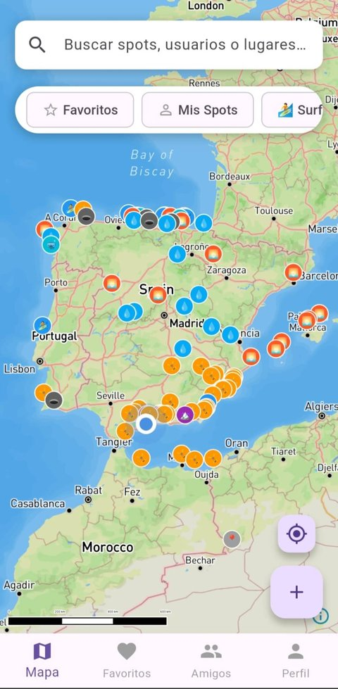
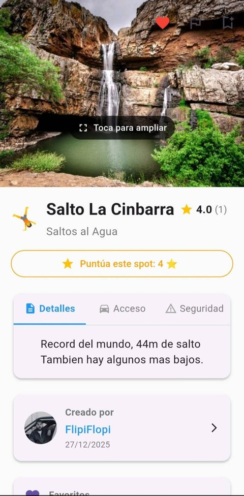
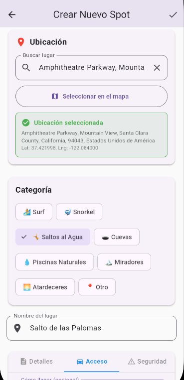
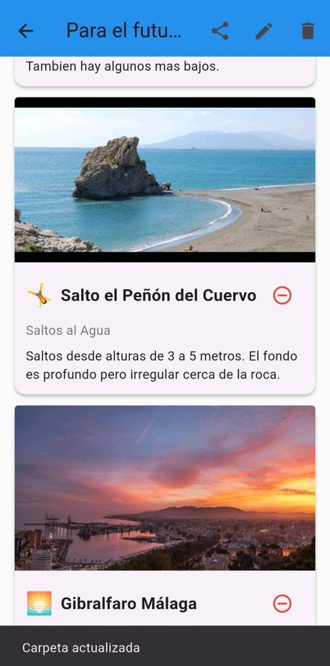

<div align="center">

# 🗺️ AdventureMap

**A community map for discovering and sharing outdoor spots — hidden beaches, hiking trails, viewpoints and more.**

Built with Flutter and Firebase · Live on Google Play

[](https://play.google.com/store/apps/details?id=com.adventuremap.app)


</div>

<p align="center">
  
  &nbsp;&nbsp;
  
</p>

---

## Overview

AdventureMap lets users pin places worth visiting, browse what the community has found nearby, organise favourites into shareable folders and plan trips with friends. Every new spot goes through a moderation queue, and contributors climb a ten-level **Adventure Rank** (from *Newbie* to *Mythic*) by publishing quality content.

The app is published on Google Play and fully localised in English and Spanish.

## Screenshots

| Explore the map | Spot details | Add a new spot | Favourite folders |
|:---:|:---:|:---:|:---:|
|  |  |  |  |
| Category filters, favourites and your own spots on one map | Photo gallery, ratings and Details / Access / Safety tabs | Place search or map picker, eight categories | Organise spots into folders and share them |

## Features

**Discover**
- Interactive Mapbox map with category filters and "spots near me"
- Place search with OpenStreetMap Nominatim geocoding
- One-tap navigation to any spot with the user's preferred maps app

**Contribute**
- Create spots with photos, description, access and safety notes, and an exact location picker
- Categories for surf, snorkelling, cliff jumping, caves, natural pools, viewpoints and sunsets
- Five-star community ratings
- Suggest edits to other users' spots; report spots or comments
- Content validation and image compression before upload

**Organise and share**
- Favourites grouped into folders, shareable through deep links
- Custom routes that chain several spots together
- Friends system with requests and public profiles

**Community and moderation**
- Moderation queue for new spots, suggestions and reports, plus an archive
- Adventure Rank gamification based on contribution score
- Push notifications (favourites, comments, approvals, friend requests) with per-type settings, delivered by Cloud Functions in the recipient's language

**Experience**
- Onboarding flow, light and dark themes, English and Spanish

## Tech stack

| Area | Technology |
|---|---|
| App | Flutter 3.29, Dart 3, Riverpod |
| Maps and location | Mapbox Maps SDK, Google Maps, Geolocator, Geocoding, Nominatim |
| Backend | Firebase Auth (email + Google Sign-In), Cloud Firestore, Cloud Storage |
| Notifications | Firebase Cloud Messaging, flutter_local_notifications, Cloud Functions (Node.js) |
| Localisation | `flutter_localizations` + ARB files (EN / ES) |

## Architecture

The code is organised by feature, with shared state and data access kept out of the UI:

```
lib/
├── features/          # One folder per feature
│   ├── map/           #   Home map
│   ├── spots/         #   Create, edit, detail, search, report, suggest edits
│   ├── favorites/     #   Folders and shared folders
│   ├── routes/        #   Multi-spot routes
│   ├── friends/       #   Friend requests and profiles
│   ├── moderation/    #   Review queue, suggestions, archive
│   ├── profile/       #   Profile, edit profile, notification settings
│   └── auth/ onboarding/ splash/ admin/
├── providers/         # Riverpod controllers (auth, spots, routes, favourites, theme, locale)
├── services/          # Firestore, Storage, auth, location, notifications, deep links, moderation
├── models/            # Typed models (spot, user profile, folder, rank, reports…)
├── widgets/           # Shared widgets
└── l10n/              # English and Spanish translations
functions/             # Cloud Functions: localised push delivery, scheduled cleanup
```

## Running locally

This repository contains no API keys or Firebase configuration. To run the app you need your own:

1. **Flutter 3.29** — pinned through [FVM](https://fvm.app) (`fvm use`).
2. **A Firebase project** with Authentication, Firestore, Storage and Cloud Messaging enabled. Generate the config with the FlutterFire CLI, which overwrites `lib/firebase_options.dart` and creates `android/app/google-services.json`:
   ```bash
   flutterfire configure
   ```
3. **Mapbox tokens** in `~/.gradle/gradle.properties` (outside the repository):
   ```properties
   MAPBOX_DOWNLOADS_TOKEN=sk.your-secret-downloads-token
   MAPBOX_ACCESS_TOKEN=pk.your-public-token
   ```
4. Run the app, passing the public token to Dart as well:
   ```bash
   flutter pub get
   flutter run --dart-define=MAPBOX_ACCESS_TOKEN=pk.your-public-token
   ```
5. Optionally deploy the notification functions:
   ```bash
   cd functions && npm install && firebase deploy --only functions
   ```

## Author

Built by [flipiflopi](https://github.com/flipiflopi). App support: adventuremap.help@gmail.com.
